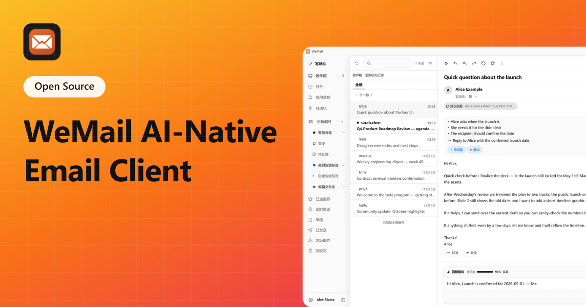

<p align="center">
  
</p>

<h1 align="center">WeMail</h1>

<p align="center">
  <strong>A local-first AI email client for people who live in their inbox.</strong><br>
  本地优先的 AI 邮件客户端 — 在你的电脑上整理邮件,并接入你选择的 AI 服务。
</p>

<p align="center">
  <strong><a href="https://eddiezywang.github.io/wemail/">Visit the project website →</a></strong>
</p>

<p align="center">
  
  
  
</p>

<p align="center">
  English | <a href="README.md">简体中文</a>
</p>

---

WeMail syncs your mailbox over IMAP/SMTP into a local SQLite database and runs an AI
intelligence pipeline from your machine: summaries, smart tags, reply drafts,
todos, and an agent whose high-risk actions require confirmation. Authenticated
MCP clients can perform mailbox mutations without a separate WeMail confirmation.
AI requests may include mail metadata, message content, and
conversation data, and are sent to the model endpoint you configure. Remote endpoints
receive that data; a local model endpoint can process AI requests on your machine.

## Features

- **Local-first mail** — IMAP/SMTP sync into SQLite via an isolated mail-core worker; cached messages can be read offline, while sync and sending require the mail provider
- **AI summaries & smart tags** — summaries and classification depend on mail type, processing policy, and model configuration; AI proposes smart tags, you promote them, and history can be backfilled
- **Reply drafts & todos** — extract todos from applicable mail; optional reply decisions can enqueue drafts when a reply is needed. Automatic reply decisions are disabled by default in the desktop app and can be enabled with `WEMAIL_REPLY_DECISION_ENABLED=1`
- **Agent with guardrails** — a Pi-based assistant reads and acts on mail with limits (6 tool iterations, 30s per tool, 120s per run); agent-initiated sending requires confirmation
- **Automation rules** — turn recurring patterns into reusable rules; bounded, inspectable, editable
- **Digests & insight reports** — daily digests plus data-driven insight reports rendered as standalone HTML artifacts
- **Bot channels** — optional WeCom (企业微信) and Feishu streaming bot replies with chat-based action approvals
- **MCP server** — expose mailbox capabilities to trusted local clients; authenticated clients can perform write operations without an in-app confirmation
- **Local data and controls** — mail is cached locally, credentials use OS-backed secret storage in normal desktop mode, and telemetry is disabled unless configured. Mail content sent to your configured AI provider follows that provider's policies.

## Screenshot

<p align="center">
  
</p>

## Getting started

**Prerequisites:** Node.js 22.19+ (22.x) or 24.x, npm and Bun (for installing dependencies). CI uses Node 22.x. Windows is the primary development platform; the installer still requires manual acceptance, and macOS remains unverified.

```bash
git clone https://github.com/eddiezywang/wemail.git
cd wemail
bun install --frozen-lockfile # patches pi-agent exports and attempts to prepare Electron native bindings
npm run dev:desktop
```

To produce a production build:

```bash
npm run build:desktop      # renderer (Vite) + electron/server (tsc) + runtime configs
npm run package:desktop    # unpacked Windows app via the project packaging script
```

If installation reports that Electron native bindings could not be prepared, run
`npm run ensure:desktop-native` before starting or packaging the desktop app.

### Using your own LLM

WeMail talks to any OpenAI-compatible or Anthropic-compatible endpoint. Configure it
in **Settings → Model** after first launch — the API key is stored encrypted and sent to the configured model service for authentication.

## Architecture

Three layers, one process tree:

<p align="center">
  
</p>

- `electron/` — main process, mail-core & DB service workers, bot-core, updater
- `server/` — composition root (`AppComposition.ts`), IMAP/SMTP, intelligence pipeline
  (queue + processors), agent runtime, automation engine, MCP, SQLite persistence
- `app/` — renderer UI; `shared/` — cross-process TypeScript contracts

## Development

```bash
npm run typecheck          # renderer + shared
npm run typecheck:server   # server layer
npm run typecheck:desktop  # electron layer
npm run test:server        # server unit/integration/acceptance suites
npm run test:renderer      # vitest component tests
```

There is no linter; TypeScript strict mode is the static analysis gate.

## Safety model

- Drafts and agent actions **never** send mail automatically
- Agent-initiated sending and other high-risk actions require confirmation; saving drafts and certain low-risk changes to one explicitly identified message can run directly. An authenticated MCP client can send, move, or delete mail without a separate WeMail confirmation.
- Logging redacts recognized sensitive fields, but automatic redaction is not exhaustive; inspect diagnostic material before sharing it.
- Mail body and attachment caches currently have no fixed time-based purge. Application logs default to seven days; some audit and automation details use 30-day retention, with cleanup while the app runs.
- Logout deletes secrets but preserves cached mail, intelligence results, and audit logs

## Acknowledgements

- **[Cloudflare Agentic Inbox](https://github.com/cloudflare/agentic-inbox)** — the upstream project WeMail forked from
- [Pi agent runtime](https://www.npmjs.com/package/@earendil-works/pi-agent-core) — agent loop and tool protocol
- [Hono](https://hono.dev), [React Router 7](https://reactrouter.com), [TipTap](https://tiptap.dev), [Tailwind CSS 4](https://tailwindcss.com), [better-sqlite3](https://github.com/WiseLibs/better-sqlite3)

> Public CI covers type checks, unit tests, and the desktop build. Browser and Electron end-to-end tests are maintained separately; validate installers before release.
