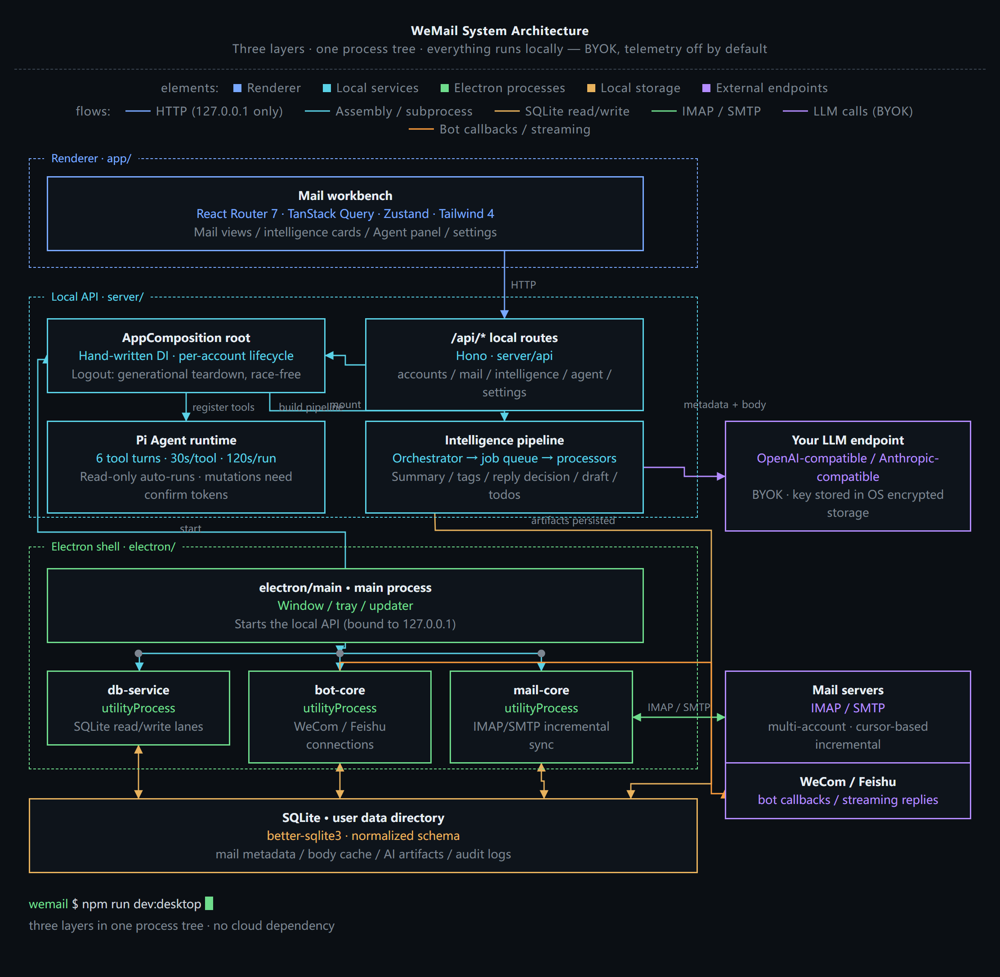

<p align="center">
  
</p>

<h1 align="center">WeMail</h1>

<p align="center">
  <strong>A local-first AI email client for people who live in their inbox.</strong><br>
  本地优先的 AI 邮件客户端 — 同步、理解、分类、行动,全部在你的电脑上完成。
</p>

<p align="center">
  
  
  
</p>

<p align="center">
  English | <a href="README.md">简体中文</a>
</p>

---

WeMail syncs your mailbox over IMAP/SMTP into a local SQLite database and runs an AI
intelligence pipeline entirely on your machine: summaries, smart tags, reply drafts,
todos, and an agent that can act on mail — with every destructive step behind an
explicit confirmation. Bring your own LLM key; nothing leaves your disk unless you
configure it.

> [!NOTE]
> WeMail is a desktop fork of Cloudflare's open-source
> [Agentic Inbox](https://github.com/cloudflare/agentic-inbox) project, reworked
> into a standalone Electron app with no cloud dependency. Huge thanks to the original
> authors.

## Features

- **Local-first mail** — IMAP/SMTP sync into SQLite via an isolated mail-core worker; your mailbox works offline and stays on your disk
- **AI summaries & smart tags** — every thread gets a summary, topics, and classification; smart tags are *your* rules: AI proposes, you promote, history backfills
- **Reply drafts & todos** — draft suggestions with reply-decision reasoning, automatic todo extraction from actionable mail
- **Agent with guardrails** — a PI-based assistant reads and acts on mail with strict caps (6 tool iterations, 30s per tool, 120s per run) and no auto-send, ever
- **Automation rules** — turn recurring patterns into reusable rules; bounded, inspectable, editable
- **Digests & insight reports** — daily digests plus data-driven insight reports rendered as standalone HTML artifacts
- **Bot channels** — optional WeCom (企业微信) and Feishu streaming bot replies with chat-based action approvals
- **MCP server** — expose mailbox capabilities to any MCP-compatible client
- **Privacy by construction** — no mail bodies in logs, 30-day retention purge, secrets in OS keychain-backed storage, telemetry only if you explicitly configure it

## Screenshot

<p align="center">
  
</p>

## Getting started

**Prerequisites:** Node.js 20+, npm. Windows is the primary development platform;
macOS builds exist but are less exercised.

```bash
git clone https://github.com/eddiezywang/wemail.git
cd wemail
bun install --frozen-lockfile # also patches pi-agent exports and rebuilds electron native bindings
npm run dev:desktop
```

To produce a production build:

```bash
npm run build:desktop      # renderer (Vite) + electron/server (tsc) + runtime configs
npm run package:desktop    # unpacked Windows app via electron-builder
```

### Using your own LLM

WeMail talks to any OpenAI-compatible or Anthropic-compatible endpoint. Configure it
in **Settings → Model** after first launch — the API key is stored encrypted and never
leaves the machine.

## Architecture

Three layers, one process tree:

<p align="center">
  
</p>

- `electron/` — main process, mail-core & DB service workers, bot-core, updater
- `server/` — composition root (`AppComposition.ts`), IMAP/SMTP, intelligence pipeline
  (queue + processors), agent runtime, automation engine, MCP, SQLite persistence
- `app/` — renderer UI; `shared/` — cross-process TypeScript contracts

## Development

```bash
npm run typecheck          # renderer + shared
npm run typecheck:server   # server layer
npm run typecheck:desktop  # electron layer
npm run test:server        # server unit/integration/acceptance suites
npm run test:renderer      # vitest component tests
npm run test:browser       # Playwright browser E2E (no Electron needed)
npm run test:e2e           # full Electron E2E with mock mail + mock LLM
```

There is no linter; TypeScript strict mode is the static analysis gate.

## Safety model

- Drafts and agent actions **never** send mail automatically
- Agent mutations require a confirmation token; read-only commands are the only auto-executed class
- Mail bodies, raw model outputs, and internal reasoning are excluded from logs and renderer responses by construction
- Logout deletes secrets but preserves cached mail, intelligence results, and audit logs

## Acknowledgements

- **[Cloudflare Agentic Inbox](https://github.com/cloudflare/agentic-inbox)** — the upstream project WeMail forked from
- [Pi agent runtime](https://www.npmjs.com/package/@earendil-works/pi-agent-core) — agent loop and tool protocol
- [Hono](https://hono.dev), [React Router 7](https://reactrouter.com), [TipTap](https://tiptap.dev), [Tailwind CSS 4](https://tailwindcss.com), [better-sqlite3](https://github.com/WiseLibs/better-sqlite3)
