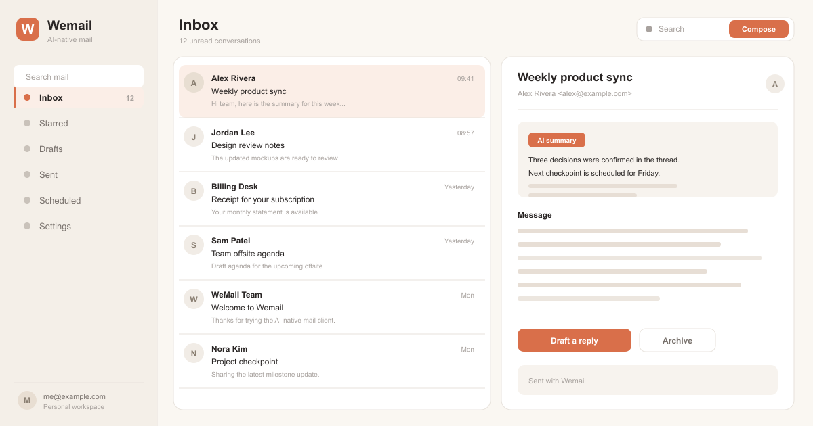
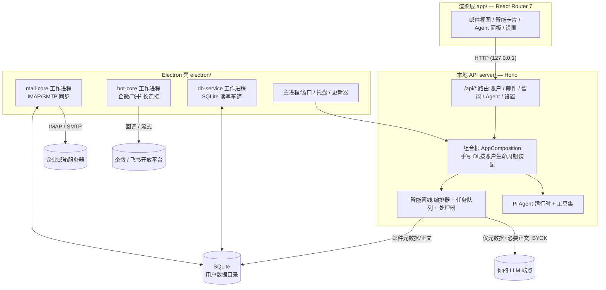
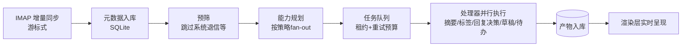
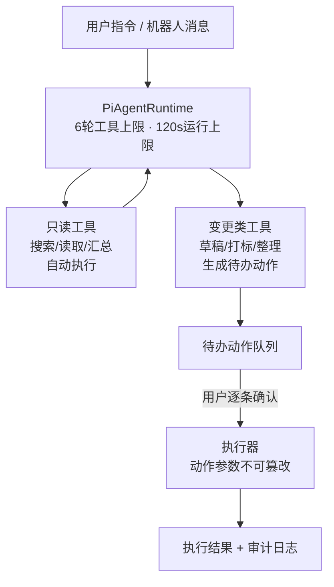

<div align="center">


# WeMail

**本地优先的 AI 邮件客户端 —— 同步、理解、分类、行动,全部在你的电脑上完成。**

[](LICENSE)
[]()
[]()

[English](README.en.md) | 简体中文

</div>

---

## 项目简介

工作邮件的真正痛点不是"收不到",而是"读不完、理不清、跟不住":每天上百封系统通知、审批流转和项目讨论混在一个收件箱里,重要信息被淹没,有价值的模式靠人肉规则勉强维持。

WeMail 把邮箱变成一个**本地运行的智能工作台**:通过 IMAP/SMTP 把邮件同步到本地 SQLite,在你自己的机器上跑完整的 AI 智能管线 —— 摘要、智能标签、回复草稿、待办提取,以及一个能替你读邮件、起草回复、执行操作的 Agent。所有 AI 能力**默认不发送任何数据到第三方**:接入你自己的 LLM Key(OpenAI 兼容 / Anthropic 兼容端点),邮件正文不出本机;遥测默认关闭。

它适合每天被工作邮件淹没、希望在本地获得 AI 辅助又不放心把邮箱交给云端服务的开发者与知识工作者。

> [!NOTE]
> WeMail 基于 Cloudflare 开源项目 [Agentic Inbox](https://github.com/cloudflare/agentic-inbox) 桌面化改造而来,已去除全部云端依赖(Workers / Durable Objects / R2 / Email Routing),成为独立 Electron 应用。感谢原作者。

## 核心能力

### 本地优先邮件引擎

**功能**:IMAP/SMTP 同步到本地 SQLite,由独立 utilityProcess 工作进程隔离运行。
**解决的问题**:邮箱数据不经过任何中间服务器,离线可用。
**价值**:数据主权 + 断网可读 + 不受云端服务停摆影响。

### AI 智能管线

**功能**:每封邮件自动产出摘要、主题分类、回复决策与草稿、待办事项。
**解决的问题**:读不完的邮件流。
**价值**:30 秒判断一封邮件"是什么、要不要回、回什么",重大降低阅读成本。

### 用户可控的智能标签

**功能**:AI 从邮件内容中发现候选主题,经你确认后晋升为正式智能标签,并异步回填历史邮件。
**解决的问题**:传统规则易碎、纯 AI 自动分类不可信。
**价值**:AI 提议 + 人确认的混合模式,分类体系完全由你掌控、随时可改。

### 带护栏的邮件 Agent

**功能**:基于 Pi 运行时的助手,可读邮件、跨账户检索、起草回复、执行整理动作。
**解决的问题**:重复性的邮箱操作(归档、打标、催办、汇总)。
**价值**:硬性安全边界 —— 单次最多 6 轮工具调用、单工具 30s、单次运行 120s;**绝不自动发信**,所有变更类操作需确认令牌。

### 自动化规则与洞察报告

**功能**:把重复模式固化为可编辑的自动化规则;日报 Digest;基于数据集的洞察报告(独立 HTML 产物)。
**解决的问题**:AI 每次从头理解的浪费,以及"邮箱发生了什么"缺乏全局视角。
**价值**:一次沉淀、持续生效;管理层视角的邮箱报表。

### 企微 / 飞书机器人接入(可选)

**功能**:把 Agent 接到企业微信 / 飞书群,流式回复(企微打字机、飞书卡片),支持群内审批待办动作。
**解决的问题**:不在电脑前时也能处理邮件事务。
**价值**:移动场景闭环,审批动作回到桌面端执行。

## 效果展示

<p align="center">
  
</p>

<!-- TODO: 补充 Agent 对话、智能标签晋升、洞察报告的动图 -->

## 应用场景

- **每日邮件分诊**:早上打开邮箱,AI 已完成摘要与分类,按"待回复 / 待办 / 通知"快速过一遍,重点邮件给出回复草稿。
- **跨项目信息聚合**:同主题邮件自动聚成标签,配合日报 Digest 掌握各项目进展,不用翻聊天记录。
- **出差 / 通勤碎片处理**:企微 / 飞书机器人里让 Agent 汇总今天的重要邮件、起草回复,回办公室确认发送。
- **制度性邮件批处理**:审批流转、系统告警类邮件固化为自动化规则,自动归档 + 提取关键信息。

## 安装部署

### 环境要求

| 依赖 | 版本 | 说明 |
|------|------|------|
| Node.js | ≥ 20 | 构建 & 运行时 |
| npm | ≥ 10 | 包管理(随 Node) |
| 操作系统 | Windows 10/11(主要)/ macOS | Windows 为主要开发与验证平台 |

> 源码构建从 npm registry 拉取 Electron 二进制与原生模块(better-sqlite3 会按 Electron ABI 自动重建);内网环境建议先配置镜像。

### 方式一:源码构建(标准)

```bash
git clone https://github.com/eddiezywang/wemail.git
cd wemail
bun install --frozen-lockfile # 自动修补 pi-agent exports 并重建 Electron 原生绑定
npm run build:desktop   # 渲染层(Vite)+ 主进程/服务层(tsc)+ 运行时配置
npm run package:desktop # 产出 Windows 未打包应用(electron-builder)
```

### 方式二:开发模式运行

```bash
npm run dev:desktop   # Vite dev server + Electron 主进程热启动
```

### 验证安装

构建完成后执行 `npm run typecheck:server && npm run typecheck:desktop`,两者通过即环境就绪;或直接 `npm run test:browser` 跑一套无需 GUI 的浏览器 E2E。

## 快速开始

```bash
npm run dev:desktop        # 启动应用
# 1. 首页添加邮箱账户(IMAP/SMTP 地址 + 凭据)
# 2. 设置 → 模型:填入你的 LLM 端点与 API Key(OpenAI / Anthropic 兼容)
# 3. 等待首轮同步,智能管线自动开始工作
```

## 使用说明

- **邮箱连接**:设置 → 账户,支持多账户;凭据存入操作系统级加密存储(safeStorage)。
- **AI 配置**:设置 → 模型,BYOK(Bring Your Own Key);未配置时应用可正常收发邮件,智能功能降级。
- **智能标签**:邮件详情卡的候选主题 → "晋升为标签" → 确认名称与规则 → 历史邮件自动回填。
- **Agent**:侧边栏助手面板,自然语言下指令;涉及变更的操作生成"待办动作",由你逐一确认执行。
- **机器人**(可选):设置 → 连接,配置企微 / 飞书机器人回调。
- **MCP**:内置 MCP server,可把邮箱能力暴露给任意 MCP 客户端(设置中开启)。

## 系统架构

三层结构、单进程树,全部运行在本机:



- **渲染层**不直接触达任何外部服务,一切经本地 API;`shared/` 承载跨进程类型契约。
- **服务层**与主进程一起由 tsc 编译,无独立后端部署。

## 核心工作流程

邮件从同步到智能产物的流水线:



关键设计:队列带**租约与过期回收**,AI worker 并发数可配(默认 4,上限 8),单条失败不阻塞整批;LLM 调用错误区分可重试/不可重试。

## AI 工作流程

### Agent 架构



安全模型内建于运行时而非提示词:无 `send_mail` 工具,变更类操作全部走"待办动作 → 确认令牌 → 执行"链路,执行参数与确认时严格一致。

### Prompt 管线

智能管线各处理器(摘要 / 标签 / 回复决策 / 草稿 / 待办)各有独立提示词,统一模式:**结构化输入(邮件元数据 + 清洗后正文)→ JSON 约束输出 → zod 校验入库**。标签体系分层:内置分类(固定)、用户智能标签(编译为分类提示)、AI 候选主题(仅提议,晋升前不影响历史组织)。

### LLM 使用方式

- **完全 BYOK**:OpenAI 兼容或 Anthropic 兼容端点,Key 存于系统加密存储,不上传。
- 可选配置免费试用签发服务(默认关闭,需显式配置端点)。
- 无任何内置模型转售;智能管线与 Agent 共用同一 LLM 配置。

## 技术栈

| 层级 | 技术 | 用途 | 选型理由 |
|------|------|------|---------|
| 桌面壳 | Electron 41 | 窗口/托盘/更新/utilityProcess | 跨平台 + 多进程隔离 |
| 渲染层 | React 19 + React Router 7 | SPA UI | 类型安全路由,SSR 同构能力 |
| 状态 | TanStack Query 5 + Zustand 5 | 服务端状态 + 本地状态 | 缓存治理与轻量全局态 |
| 样式 | Tailwind CSS 4 | 原子化样式 | 无运行时开销 |
| 富文本 | TipTap 3 | 邮件编写 | 可扩展、协作编辑生态 |
| 本地 API | Hono | HTTP 路由 | 轻量、类型推断好 |
| 邮件 | imapflow + nodemailer | IMAP/SMTP | 成熟的协议实现 |
| 存储 | better-sqlite3 | 本地数据库 | 同步 API,性能好 |
| Agent | @earendil-works/pi-agent-core | Agent 循环/工具协议 | 硬护栏在运行时层实现 |

## 项目结构

```text
wemail/
├── electron/        # Electron 主进程 + mail-core/db-service/bot-core 工作进程
│   └── main/        #   窗口、托盘、更新器、本地 API 启动
├── server/          # 本地 API 与全部业务逻辑(Hono + TypeScript)
│   └── wemail/
│       ├── bootstrap/    # 组合根:AppComposition 手写 DI
│       ├── mail/         # IMAP/SMTP 提供者、同步服务
│       ├── intelligence/ # 智能管线:处理器、队列、智能标签
│       ├── agent/        # Pi Agent 运行时、工具集、待办动作
│       ├── channels/     # 企微/飞书机器人
│       ├── automation/   # 自动化规则引擎
│       ├── mcp/          # MCP server
│       └── database/     # SQLite schema 与迁移
├── app/             # React 渲染层(React Router 7)
├── shared/          # 跨进程 TypeScript 契约
├── skills/          # 内置 Agent 技能
├── tests/           # 浏览器 E2E / Electron E2E / 渲染层测试
└── services/        # 可选运营服务(免费试用签发)
```

## 配置说明

核心配置均在应用内完成;环境变量仅用于开发与运维覆盖(完整清单见 `.env.example`):

| 变量 | 默认 | 说明 |
|------|------|------|
| `WEMAIL_TELEMETRY_*` | **空(禁用)** | 遥测端点;不配置则零上报 |
| `WEMAIL_FREE_TRIAL_*` | **空(禁用)** | 免费试用签发;不配置则入口隐藏 |
| `WEMAIL_LLM_BASE_URL` | 空 | E2E 测试用 mock LLM 端点 |
| `WEMAIL_AI_WORKER_CONCURRENCY` | 4 | 智能 worker 并发(1-8) |

## 安全设计

- **绝不自动发信**:草稿与 Agent 动作都不会自动发送
- **正文不出现在日志**:AppLogger 拒绝敏感键;审计日志不含邮件正文
- **变更需确认**:Agent 变更类操作全部走确认令牌链路
- **登出保留数据**:删除凭据但保留缓存邮件、智能产物与审计日志
- **留存策略**:正文/附件缓存与日志 30 天自动清理
- **遥测默认关闭**:端点不配置则零上报(见配置说明)

## 项目亮点

1. **隐私优先的 AI 邮件**:智能能力完整,BYOK 且数据不出本机 —— 与"云端读你邮箱"的产品形成根本差异。
2. **运行时硬护栏**:Agent 限制(轮数/时长/无发送工具/确认链)实现在运行时层,不依赖提示词自觉。
3. **混合智能标签体系**:AI 候选 → 人确认 → 规则沉淀 → 历史回填,兼顾自动化与可控性。
4. **单进程树完成全部隔离**:mail-core / db-service / bot-core 各自 utilityProcess,崩溃互不传染。
5. **桌面化改造完整**:从 Cloudflare Workers 架构完整迁移到本地优先架构,无云端残留依赖。

## Roadmap

- [ ] macOS 平台同等验证
- [ ] 更多邮箱目录适配(Coremail 之外)
- [ ] 洞察报告模板市场
- [ ] 自动化规则可视化编排

## 贡献指南

欢迎 Issue 与 PR。开发环境见[安装部署](#安装部署),提交前请跑通 `npm run verify:pr`(schema 检查 + 三层 typecheck + 服务端单测 + 渲染层测试)。

## FAQ

**必须配置 LLM 才能用吗?**
不必须。未配置时邮件收发、浏览、搜索完全可用,智能功能(摘要/标签/草稿/Agent)降级隐藏。

**我的邮件数据存在哪?**
本机用户数据目录下的 SQLite,以及正文缓存。详见安全设计的留存策略。

**支持 Exchange / Gmail?**
任何提供 IMAP/SMTP 的邮箱均可连接;专属协议(如 EWS)暂不在计划内。

## License

Apache-2.0。基于 [Cloudflare Agentic Inbox](https://github.com/cloudflare/agentic-inbox) 改造,遵循其原许可与署名要求,详见 [LICENSE](LICENSE)。
