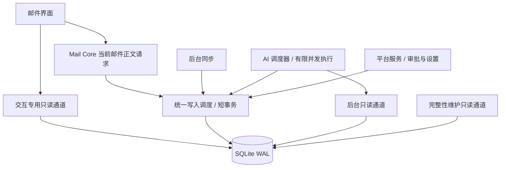

# 邮件阅读优先的架构复审与实施

状态：实施中，完整方案尚未完成，尚未本地启动用户验收实例。更新于 2026-11-03。

目标：保留 Electron、SQLite WAL、本地正文缓存、Mail Core 和数据库服务，通过资源隔离、统一写调度和有界维护，让读取邮件不依赖 AI、审批或后台同步的完成。最终完成全量相关验证后，快速启动开发版本供用户验收。

## 目标结构

这是目标边界图，不代表所有边界已经实现。独立 reader 仍共享 CPU、磁盘和数据库文件，需要结合后台准入、有限批次与短事务。主进程中的平台 API 和多个 repository 尚未迁出，也仍存在 writer 之外的平台写入口。

## 当前实施状态

| 范围 | 已实施 | 尚未证明或完成 |
| --- | --- | --- |
| 阅读通道 | 可信端口绑定 interactive/background 身份，重连保留身份，AI/API 使用独立后台 reader，跨通道取消不重启前台 reader | 完整点击到正文绘制 trace、用户可见交互与持续高负载验收 |
| AI 调度 | AiJobDispatcher 串行领取、合并到期发现/空队列状态、统一退避与单个唤醒定时器；保留 pool 并发调整和任务租约。终态重试恢复按主键每批检查最多 100 行，固定本轮上界，空批只读，批次间让出；模型变更恢复完成或部分失败后再次唤醒调度器 | 大量未来任务、其他账号任务下的候选查询成本；三万恢复任务下的数据库线程验收已完成，实际窗口与 AI 执行积压验收仍待完成 |
| AI 持久化 | 用量、标签关系、待办、内容主题/标签建议、回填终态计数迁入 writer；租约和正文版本守卫；缓冲提交确认后才触发完成动作 | 自动化执行服务内部的同步 repository 尚在主进程 |
| 审批读取 | GET 通过 agent.listPendingActions 后台只读接口，账号/会话所有权检查及只读过期状态推导；失败返回 503 | 审批执行写入口等平台服务迁移 |
| 计数维护 | migration 13 一次校准，账号/文件夹/分类/标签计数以源表触发器维护增量；删除 writer 全部 rebuildCounts 调用 | 持续同步与多账号真实交互验收 |
| 通知偏好 | reader 读、writer 写，提交发布 setting 变更；主进程只使用事件驱动内存快照，旧读取不覆盖新设置，无关事件不读库 | 设置读取失败期间暂时暂停通知；后续事件或通知冷却后按需恢复 |
| 数据保留 | 六类 SQL 清理迁入 writer 后台队列，每表每批最多 100 行，批次间让出执行机会、失败整批回滚、停止取消后续批次；migration 14 补索引 | 日志文件清理仍由平台服务执行，SQL 候选查询成本需持续观测 |
| 启动检查 | 独立 maintenance reader 按需启动并完整检查，成功后主进程只打开现有连接并核对 schema；迁移仍由 writer 负责。主进程首次就绪等待设为 180 秒以容纳冷盘升级完整性检查，查询超时保持不变 | 平台服务内部 SQL 和锁等待仍未整体消除；升级时迁移检查和启动门禁可能各执行一次；180 秒仅为启动等待预算，不是性能达标 |
| 频道任务领取 | 收件与投递领取经异步 RPC 进入 writer 后台队列；空队列先只读，实际领取采用短事务条件更新；停止时丢弃迟到结果 | 仍按 750ms 周期触发异步领取，尚未改为事件唤醒；结算、入队及其他频道业务 SQL 仍在平台服务 |
| 通讯录 | 领域读写分别进入后台 reader/writer。migration 15 引入持久快照版本、唯一有效/暂存版本约束和有效版本视图；每段最多 100 联系人/部门，拼音生成在段事务外；发布只切换元数据且可幂等确认。旧版本/过期暂存每表每批最多 100 条回收，FTS 删除通过稳定 storage_id 联动；进程重开可续传，发布前旧数据保持可读。列表/计数同一只读事务，每页最多 1000 条，所有生产调用方等待异步结果 | 实测三万联系人单批峰值仍有 815ms，需继续定位计算/检查点/I/O 成本；单页上限不保证模糊搜索和计数成本恒定 |
| 阅读 trace | 点击处创建 trace，预取与详情查询传递同一标识，正文就绪和绘制阶段可与数据库 queueMs/handlerMs 关联；正文组件传递请求标识，旧 iframe 绘制回调不能完成同邮件的新 trace | 仍需真实窗口采样与持续负载验收；尚未覆盖所有导航入口和保留 iframe 再次显示的绘制采样 |
| 正文组件 | 补齐加载参数，展开后保留 iframe，避免折叠再展开重建正文 | 实际邮件详情打不开的最终因果链与用户可见修复验收 |

## 必须成立的行为

1. 已缓存正文的展示只依赖交互 reader；不等待标记已读、审批清理、AI 结果、网络连接或后台队列。
2. 未缓存正文先展示已有元数据，再发起当前邮件补取。Mail Core 为交互请求保留执行机会；正文持久化可插队后台待执行写入。正在执行的同步 SQL 不能抢占，后台必须限制单次工作量。
3. AI 摘要、分类等独立显示加载或失败状态，不能决定正文是否可见。后台失败不能触发整个邮件详情持续重新加载。
4. 主进程负责窗口、凭据与进程生命周期；不能承载长 SQL 或同步锁等待。平台服务迁出主进程仅解决 UI 线程阻塞，统一写入口才能进一步控制数据库竞争。
5. 写请求成功必须对应已提交事务；所有权校验、幂等和失败恢复保留。超时发生在提交后时不能简单自动重试非幂等操作。

## 队列设计

- AI pool 由一个调度器管理唤醒、退避和可执行容量。执行 worker 接收已领取任务，不各自轮询数据库。领取数量不超过空闲执行槽，避免提前领取大量任务导致租约失效。
- 持久队列保留重启恢复能力；事件用于唤醒，最近到期时间用于处理延迟重试，启动时做有界恢复。事件不是唯一事实来源，不能因丢事件永久漏任务。
- 任务领取不关联正文/邮件宽表。维护可索引的排序依据，按类型读取候选，再合并候选。空领取不取写锁，实际领取使用条件更新及短事务。
- 租约回收由单一维护者分批执行，不附带在每个 worker 的领取里。恢复后必须有唤醒或到期调度，不能留下无人消费的任务。
- 仅持久化排序键仍不能保证严格固定查询成本：大量未来任务或其他账号任务可能被过滤跳过。第一阶段测量这类场景；若不达标，再把延迟任务和 ready 队列分离，由到期调度器推进状态。不能宣传当前查询已是恒定开销。
- 队列优先级只能影响下一条请求。长事务、无界批处理、重建索引都应分批并让出执行机会；不能靠延长超时解决吞吐不足。

## 分阶段实施

### 第一阶段：保护阅读路径

在可信的端口绑定处区分前台和后台客户端，不能允许任意调用者自行声明高优先级。复用现有 reader 实现，为后台快照读取设独立的受限通道；保留取消请求能力且不影响其他通道。涉及 shared 协议、数据库端口绑定/路由、producer、reader 和前台取消测试。

同时逐段记录点击 trace：点击、快照排队、查询结束、正文到达、正文绘制。记录耗时、状态及大小，不记录正文、主题或收件人。对已有缓存和缺失正文分别归因，先证明读链路的实际阻塞点。

### 第二阶段：收拢后台调度

在现有 AI pool 上收拢领取和到期定时器，保留现有 worker 执行业务逻辑、并发设置和退出语义。合并启动维护，后台批次受前台压力与执行容量约束。先验证当前排序候选方案，再决定是否引入 ready/delayed 状态分离。

### 第三阶段：消除主进程同步数据库工作

枚举平台 repository 的读写入口，优先迁移会周期执行、会在 GET 中写入和会长时间等待的操作。目标为异步服务接口和统一数据库写调度；凭据仍由主进程受控提供。按领域迁移，禁止一次性让所有 repository 变成无类型的任意 SQL RPC。

## 当前验证证据与限制

- 曾完成数据库升级与启动诊断；启动证据不能替代正文交互验收。历史副本验证阶段的数据与本机路径不在公开文档中列出。
- 实际运行发现 nextQueueDue 的 leased MIN 查询使用 job_kind 普通索引扫描历史作业，AI/body 两类分别约 3188/2124ms。migration 16 增补按 kind/account 的 leased/pending 部分覆盖索引并明确查询索引；租约与迁移定向 6 项通过。当前运行实例尚未应用 migration 16，不能声称线上排队已经恢复。
- AI 终态恢复、租约与 canonical worker 合计 26 项通过，producer 的分段/失败/游标校验 5 项通过，server/desktop 类型检查及窄范围编译通过。新增空恢复页在另一连接持有 BEGIN IMMEDIATE 时仍能返回，证明空批不取写锁；本轮固定上界不包含晚到任务，遇到无可恢复批次仍继续推进。
- 编译后真实 writer/detail 线程，两个 fixture 账号、三万条终态 AI 任务恢复：共恢复 30003 条（含正文准备生成的三条 AI 作业），301 批；并发 184 次缓存正文读取及标记已读，读取 P95 4.27ms/最大 7.17ms，交互写入 queueMs+handlerMs P95 58ms/最大 77ms，恢复批次 handler P95 14ms/最大 89ms。此轮在空批只读优化前测得；没有真实 LLM/网络/renderer，不代表用户可见点击验收，临时数据已清理。
- 本轮优化旧通讯录 FTS 迁移：先单次聚合到带主键的临时表，再按账号/联系人关联，避免逐联系人扫描 FTS 的 UNINDEXED 字段；临时表随迁移事务清理。通讯录和迁移定向 30 项通过，正文组件 11 项及 trace 2 项通过，窄范围编译通过。renderer 类型检查仍为下述七项既有错误。
- 实库副本 11→15 纯迁移首次测得 75005ms，优化后另一轮 139014ms，分阶段复测 24224ms（通讯录迁移 1284ms、quick_check 19531ms、foreign_key_check 2584ms）。备份分别约 11/57/16 秒，负载和 I/O 波动明显，不能将非受控总耗时比较当作性能收益；原库未修改，备份副本已清理。139 秒暴露 30 秒启动等待不适用于冷盘升级，首次等待调整为 180 秒；实际桌面启动仍待验证。
- 最新 server/desktop 类型检查和 `npm run build:desktop:main:quick` 通过。
- 频道相关 26 项测试通过 22 项、失败 4 项；用 HEAD 版本 worker/repository 与原测试副本复跑，四项失败同样存在（飞书回复及分块恢复预期）。新增只读空领取、数字序列化/独占租约、远程失败不回退、停止丢弃迟到领取四项均通过。编译后真实 writer 线程领取、拒绝重复领取及非法参数冒烟通过。临时基线文件、脚本和数据库已清理。
- 点击 trace 的复用、重新点击替换、旧结果隔离、绘制只完成一次与日志不带邮件标识两项测试通过。renderer 类型检查仍为下述七项既有错误，未出现本次 trace 改动相关类型错误。
- 补入点击与预取 trace 后，邮件查询/正文组件相关 17 项测试通过。尚未据此宣称真实窗口 P95/P99 达标。
- 通讯录 repository/service/拼音相关 25 项测试通过，producer 分段传输及失败中止 2 项测试通过，新增会话过期保护 1 项通过；server/desktop 类型检查与窄范围编译通过。编译后的 producer 连实际 writer 线程发布 250 联系人并从新只读连接核对计数/拼音查询，耗时 47ms；这只是小 fixture 冒烟，不是大通讯录延迟保证。
- 通讯录异步查询改造后，repository/service、路由、Agent 工具与发信签名相关 32 项测试通过，覆盖只读约束、分页/账号隔离、失败不回退、API 等待结果、签名失败降级和刷新启动状态。server/desktop 类型检查、窄范围编译通过。
- 编译后的 producer 连实际 writer 与 background reader：分段发布 250 联系人，验证分页/总数、按邮箱查找、跨账号拒绝匹配、部门数字字段、状态与非法读操作拒绝，均通过；临时数据库、脚本与线程已清理。
- migration 15 与版本化发布后，通讯录/迁移/保留 35 项测试通过；旧结构迁移（含缺失/重复 FTS）1 项、收件人名称补全 1 项、发布幂等确认聚焦测试通过，producer 2 项通过。发布期间禁止联系人 INSERT/DELETE 的触发器未被触发，证明发布不再重写数据；独立只读事务跨发布和回收保持旧快照，事务结束后看到新快照。
- 编译后真实 writer 线程分 300 段写入三万联系人，总耗时 8742ms；发布 handler 1ms、排队 0ms；写段 handler 最大 815ms。旧三万联系人分 301 批回收，批次 handler 最大 148ms，再次空版本发布 1ms。不是 renderer 点击延迟验收，峰值尚未归因。
- 本轮设置路由/偏好、分批保留、迁移、通知快照、平台连接门禁合计 49 项测试通过。编译后真实 writer/background/maintenance 线程冒烟覆盖偏好提交后可读、清理批次、完整性检查、维护线程隔离和非法参数拒绝，均通过。
- 前序验证：migration、writer、四类 processor 和待办持久化 131 项通过；buffer/worker/pool 24 项通过；审批只读/异步代理/所有权相关 9 项通过；正文组件 4 项、调度器 5 项通过。这些计数有重复覆盖，不作为全仓测试总数相加。
- renderer 类型检查仍失败，最新为 7 项既有错误：AgentPanel executionResult 类型、AdvancedSection bridge 类型、McpSection CopyButton 参数、ModelSection 的两处空值类型、AppTitlebar 两处不可达比较。未擅自改动这些并行源文件，未记为通过。
- 扩大检查仍有已知失败：QueryRepository 分页数量及搜索 fixture 约束、agentRoutes 两项聊天错误文本断言、IntelligenceResultRepository 两项摘要重试 mock 分页断言。SummaryProcessor 旧超时预算断言已修正，不能因此声称整体测试全绿。
- 使用只读备份验证数据库升级与完整性检查，原数据库未修改；具体用户数据规模不在公开文档中列出。
- 编译后的真实线程在实库临时副本上预热后，各读取 100 次缓存快照：空闲 P95/P99 为 3.01/4.77 ms，并发为 3.28/5.17 ms。并发期间仅有 2 次 AI tags 事务和 95 次后台读取，因此是小规模通道隔离冒烟，不代表持续重负载或 renderer 绘制延迟。临时脚本和数据库副本已清理。

## 验收要求

建议验收目标（待在本机建立基线，不是已测结果）：缓存正文点击至可见 P95 ≤ 200ms、P99 ≤ 500ms；后台 AI 高负载时 P95 相比空闲增加不超过 100ms。首次加载、超大正文和冷磁盘另列，不混入热缓存指标。

必须覆盖：空闲/三万条 AI 积压/AI 超时/持续同步/多账号/连续切换邮件/冷启动/进程崩溃租约恢复。核对用户可见正文、网络请求、trace 和数据库队列时间；进程存活或 HTTP 200 不算交互通过。缺失正文受网络影响，分别报告本地排队时间与网络下载时间。

数据迁移只执行一次并具备事务回滚；新增迁移后旧版本可能拒绝打开数据库，发布前需要明确兼容与恢复路径。当前候选触发器须验证 late metadata、时间更正、删除、重复入队以及历史任务回填。

## 尚待完成

1. 继续按领域迁移平台 API、账号、频道、自动化等同步数据库入口，消除主进程长 SQL/锁等待，收拢平台写调度，保留凭据权威与业务所有权校验。
2. 补齐点击、读取排队、查询、正文到达与绘制 trace，执行上述全部负载和故障场景；不能用数据库线程的快照延迟替代用户可见验收。
3. 关闭或明确处理完整类型检查与扩大测试中的失败，执行与跨进程改造范围匹配的完整验证。
4. 完成窄范围构建后，按仓库快速启动流程启动实际开发版本，核对真实数据目录日志、进程、窗口和实际正文展示，交由用户验收。

当前目标已授权测试、窄范围构建和本地快速启动，不需要再次索要这些操作的许可。未授权打包、安装、发布，也不改动 Electron 原生绑定 ABI。
